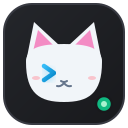

# 🐾 Status Bar Pet — The Developer Companion for JetBrains IDEs

  

  <b>A lightweight, non-intrusive animated pet living directly in your status bar.</b> 
  <i>Gamify your coding sessions, track Pomodoro sprints, and keep stress away with tactile petting.</i>

  
  
  
  
  

---

## 💡 Why Status Bar Pet?

Coding for hours can be solitary and exhausting. Heavy desktop pet overlays or sound-heavy plugins often distract you from your editor or break your concentration.

**Status Bar Pet** solves this by resting quietly in your IDE's status bar:
* **Never steals focus:** Operates strictly within the status bar bar area at the bottom of your IDE.
* **100% Silent:** No unexpected chimes, beeps, or audio interruptions during meetings or deep focus.
* **Pure Vector Rendering:** Handcrafted Java2D vector graphics that look razor-sharp on HiDPI and Apple Retina displays with zero pixel blur.
* **Zero Performance Tax:** Includes a strict *"Freeze Movement"* mode with **0% CPU overhead** when you need absolute stillness.

---

## ✨ Features in Detail

### 🐾 1. Tactile Mouse Petting (Zero-Click Anti-Stress)
When debugging hits a brick wall or you're waiting for a build to finish, simply move your mouse cursor over the pet and **gently rub back and forth**. 
* The pet responds immediately with a soothing vibration animation, blushes, and releases floating hearts ❤️.
* **No clicks required:** Interaction is completely natural and effortless.

### ⌨️ 2. Real-Time Typing Companion
* **Keystroke Sync:** The pet's paws mirror your typing cadence on its own miniature laptop while you code.
* **Code Deletions:** Deleting lines or holding backspace triggers a quick crumpled paper-ball animation into a wastebasket.
* **File Save Badge:** Saving your code (`Ctrl+S` / `Cmd+S`) displays a crisp `[✓ SAVED]` badge.
* **Test & Build Reactions:** Pet cheers for green test suites and provides moral support when runs fail.

### 📈 3. Natural Flow-State XP & Level Progression
* You earn experience points (XP) simply by doing what you already do: **writing code**.
* XP accumulates automatically based on your active coding time and keystroke volume.
* Climb through 9 developer career ranks from **Intern** up to **Distinguished Fellow** and unlock permanent cosmetic accessories.

### 👑 4. 8 Unlockable Accessories
Customize your companion as you level up. Mix and match hats, glasses, and gear:

| Level | Title | Unlockable Accessory | Description |
| :---: | :--- | :--- | :--- |
| **Lv. 1** | Intern | — | Clean natural mascot |
| **Lv. 2** | Junior Developer | 🎀 **Dapper Bowtie** | Classic red gentleman's bowtie |
| **Lv. 3** | Junior Developer | 🎧 **Coding Headphones** | Over-ear studio audio monitors |
| **Lv. 5** | Mid-Level Developer | 👓 **Hacker Glasses** | Sleek rectangular dark shades |
| **Lv. 7** | Senior Developer | 🎩 **Wizard Hat** | Midnight blue starry wizard hat |
| **Lv. 9** | Tech Lead | 🏴‍☠️ **Pirate Captain Hat** | Skull-and-crossbones captain bicorne |
| **Lv. 12** | Staff Engineer | 👑 **Golden Crown** | Polished royal gold crown with jewels |
| **Lv. 15** | Principal Architect | 😇 **Angelic Halo** | Radiant floating golden halo |
| **Lv. 20** | Distinguished Fellow | ⚔️ **Viking Horns** | Iron warrior horned helmet |

### 🍅 5. 25-Minute Pomodoro Focus Timer
Maintain healthy flow cycles without needing a separate browser tab or mobile app.
* **1-Click Launch:** Right-click the pet to start a 25-minute focus session.
* **Live Status:** Hover tooltip shows remaining minutes and seconds in real-time.
* **Gentle Notification:** A polite, non-modal balloon notifies you when it's time for a 5-minute stretch and water break.

### 💤 6. Inactivity Sleep & Zero-Motion Freeze
* **Auto Sleep:** After 35 seconds without editor keystrokes, your pet gently curls up to sleep with floating `Zzz` particles.
* **Pause / Freeze:** Toggle *"Freeze Movement"* from the menu to lock the pet into a static icon with **0% background CPU usage**.

---

## 🐶 Meet the Mascots

Switch between 3 distinct companions anytime via right-click:

* 🐱 **Mochi the Cat:** Calm, sweet, and loves curling up during long architecture and refactoring sessions.
* 🐶 **Sparky the Corgi:** High-energy developer pup who wags his tail at every commit and green test.
* 🦆 **Quackers the Rubber Duck:** The time-honored symbol of rubber duck debugging, always ready to hear you explain your logic.

---

## 🎮 How to Interact

| Action | Result |
| :--- | :--- |
| **Hover & Rub Mouse** | Triggers tactile purring vibration and floating hearts ❤️ |
| **Left Click** | Shows full status tooltip: Pet name, Level, Current XP, Pomodoro status |
| **Right Click** | Opens interactive menu: Switch Mascot, Equip Accessories, Toggle Pomodoro, Pause Movement |
| **Type in Editor** | Awards active typing XP and triggers keyboard tapping animation |

---

## 🖥️ Compatibility

Compatible with **JetBrains IDE 2024.1+** across all platforms (Windows, macOS, Linux):
* **PyCharm** (Community & Professional)
* **IntelliJ IDEA** (Community & Ultimate)
* **WebStorm**
* **GoLand**
* **Rider**
* **PhpStorm**
* **CLion**
* **RustRover**
* **Android Studio**

---

## 📜 License

Distributed under the **MIT License**. Free and open-source forever.
